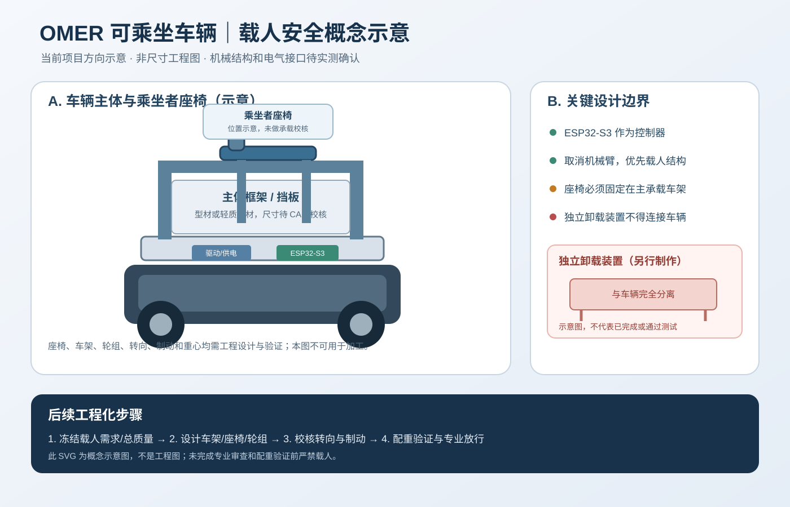

# 航天未来科技组 · OMER 太空补给服务

> 以三组文件夹中的材料为题材和任务流程参考，独立选择可行技术路线的 14 天交付方案。

本仓库目标是在 14 天窗口内（10 天各 2 小时、4 天各 12 小时，约 68 小时）完成可运行、可演示、可验收的 OMER 购物服务原型。**三组文件夹仅作为项目材料来源，不要求沿用仓库其他任何文件的架构、代码或设计；允许直接重构。**

## 先读这里

0. [项目工作进度与验收台账](docs/PROJECT_PROGRESS.md)
0. [2026–2027 可行性审查与重构门槛](docs/FEASIBILITY_REVIEW.md)
0. [40 kg 乘坐者载人车辆改造方案与安全门槛](docs/40KG_RIDER_CONVERSION.md)
0. [采购准备与设计冻结台账](docs/PROCUREMENT_READINESS.md)
0. [总体系统设计基线（理论方案版）](docs/SYSTEM_DESIGN_BASELINE.md)
0. [机械设计输入与测量记录（验收版）](docs/MECHANICAL_INPUTS.md)
0. [10月31日验收摘要与现场检查表](docs/ACCEPTANCE_BRIEF_2026-10-31.md)
0. **规则原文优先**：[D5 内 2026–2027 长期题 PDF](D5/1111111-main/2026-2027年度头脑奥林匹克长期题9.30.pdf)；设计冻结前须逐条核对 PDF，不以网页摘要替代。

1. [整合方案与技术决策](docs/INTEGRATED_PLAN.md)
1. [小组分工与交付标准（副组长负责程序编写）](docs/TEAM_ROLES.md)
1. [车辆成品概念图（非加工工程图）](docs/PRODUCT_RENDER_CONCEPT.svg)
2. [14 天学期时间表（约 68 小时）](docs/14_DAY_DELIVERY.md)
3. [具体型号采购清单（ESP32-S3 N16R8）](docs/COMPONENTS_BOM.md)
4. [ESP32-S3 引脚分配与接线安全](docs/ESP32S3_PINMAP.md)
5. [ESP32-S3 固件入口和 bring-up 步骤](firmware/esp32_s3/README.md)
6. [验收与测试清单](docs/ACCEPTANCE.md)
7. [风险与待确认事项](docs/RISKS.md)
8. [三组 30 天计划](3组/OM计划.txt)
9. [D5 旧版资料说明（归档）](D5/README.md)

## 成品概念图预览

> 该图为方案沟通用概念示意，不代表已完成 CAD 或实物验证；请勿直接按图切割、钻孔或加工。

## 载人改造重要安全说明

本项目目标车辆为可乘坐车辆，当前用户确认的需求为乘客最低体重 35 kg、车辆额定乘客承重至少 40 kg（建议在工程验证允许时提高）。原小型机器人底盘、候选电机和固件均**未获载人安全验证**，不得直接乘坐。商品抓取机械臂已从本轮优先范围取消，预算优先保障承载车架、座椅固定、轮组、转向、行车/驻车制动和急停。完整需求与分阶段放行条件见 [40 kg 乘坐者载人车辆改造方案](docs/40KG_RIDER_CONVERSION.md)。

## 项目原则

- `3组/` 目录内所有材料均为只读保护区，不得编辑、移动、重命名或删除。除该目录外，其余项目文件允许按审查结果大幅重构。`D5/1111111-main/2026-2027年度头脑奥林匹克长期题9.30.pdf` 是规则审查的首要本地来源，必须保留并逐条核对。
- 官方 2026-10-01 澄清要求：计时开始时先把购物清单交给车辆操作员，且必须在车辆越过起始线前完成；任务状态机必须显式包含清单交接门槛。
- 14 天优先打通「订单交接 → 程序自主选择缺货替代品 → 购买/装载 → 结账核验 → 按适用组别完成卸载 → 车辆/购物车按题面完成过起始线、释放和购物车返区」。官方 Problem 1 页面明确 Division 2–4 使用队伍制作的卸载装置；对这些组别，装置须与车辆分离，车载舵机/翻斗不能冒充该装置。先确认本队Division，再冻结对应要求。
- 主控统一为 **ESP32-S3 N16R8 开发板**，预算 ¥20–150；购买前确认 Flash/PSRAM 配置、USB 下载方式和引脚图。
- 当前固件是安全 bring-up 骨架，尚不是完整自动导航/任务流程程序。**商品抓取机械臂已从本轮范围取消**；预算优先用于载人结构。对Division 2–4，题目要求队伍制作的卸载装置；按题面要求与车辆分离并由队员直接人力操作。其他Division按完整题面核对适用要求。
- D5 旧 Nano sketches 仅归档供参考，不是当前目标代码；其引脚、驱动、库和电气接法不能直接用于 ESP32-S3。
- ESP32-S3 GPIO 是 3.3V 且不耐 5V 输入；超声波 Echo 等信号必须先做电平适配。引脚文档为初稿，实物核验前不可直接上电。
- 急停必须物理切断电机驱动电源，不能仅依赖固件；电机驱动使能、电机堵转电流、保险丝和线径必须在接电前核验。
- 购物车采用被动拖挂/释放的候选设计；结账后按题面让购物车穿过起始线垂直平面，车辆停车并释放，购物车最终停在购物车区域，车辆保持在起始线上或其外侧。该流程仍需实测和活动手册/官方澄清复核。
- 预算上限为 **165 美元**，按赛事成本核算口径记录实际购买成本；人民币预算只是采购估算，不等于规则成本已核验。
- 海淀只作为团队计划的训练/收货区域约束：采购优先中国大陆现货、北京/华北仓和明确到货日期；不推断具体地址或场地已经落实。

## 当前可行性结论

当前判断为“有条件可行的原型方案”，不是已经验证完成的比赛解决方案。组别暂未确定，因此涉及组别差异的卸货装置和计分要求必须保留为条件项；官方 Problem 1 完整题面与最新澄清优先。重构优先级、阻塞风险和验收门槛见 [可行性审查](docs/FEASIBILITY_REVIEW.md)。

## 测试状态

仓库包含替代规则单元测试、ESP32-S3 固件草案、采购文档和引脚表，但本次操作环境没有 Arduino-ESP32 编译工具，且没有实际开发板/传感器/电机可用于实机验证。硬件、固件编译、场地和机械系统的验收项仍为“未测”。不宣称已经实机跑通。

## 许可

新编写的项目文档与代码按 **CC BY-NC 4.0** 声明许可，范围及第三方材料限制见 [LICENSE](LICENSE)。第三方赛题文件、官方图表和既有材料不因该声明自动获得再许可。
